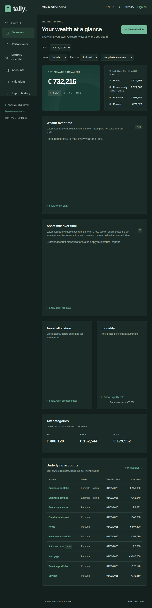

# Tally

Tally is a self-hosted wealth tracker for recording a portfolio over time. Enter
dated valuations, then explore total wealth, asset mix, investment results, and the
changes between snapshots. One Tally instance holds one shared portfolio, so your
data stays on the server you choose.



## What you can do

- Record dated valuations as drafts and publish complete snapshots.
- Review wealth, liquidity, asset allocation, investment performance, and maturities.
- Import historical observations from a CSV and export your observations.
- Use the interface in English or Dutch, with dark and light themes.
- Run Tally on your own server with local assets and SQLite storage.

Examples and screenshots use fictional data and generic provider names.

## Try it locally

You need Docker Compose v2 and GNU Make. Start a local instance pre-filled with
fictional data:

```sh
make demo TALLY_INSTANCE_NAME=tally-demo
```

Open the URL printed by the command (by default, <http://localhost:8000>) and sign
in with the username and password it prints. This creates a local development login;
the credentials persist with the instance's data. To run an empty portfolio instead,
use `make up`. See the [development guide](docs/development.md) for commands,
configuration, and running without Docker.

## Quick production deployment

This Compose setup is for a server that already has Traefik, HTTPS, and an external
Docker network configured. Set the secret, hostname, and network in `.env` first:

```sh
cp .env.example .env
chmod 600 .env
# Edit .env: set DJANGO_SECRET_KEY, TALLY_HOST, and TRAEFIK_NETWORK.
docker compose -p tally-prod -f compose.yaml -f compose.prod.yaml up --build -d
docker compose -p tally-prod -f compose.yaml -f compose.prod.yaml exec app python manage.py createsuperuser
```

Keep the database on local persistent storage and protect the hostname with HTTPS
and appropriate access controls. The app does not publish a public host port.
Read the [production deployment guide](DEPLOYMENT.md) before exposing an instance;
it covers Traefik, authentication, imports, backups, updates, and restore.

## Documentation

- [Product specification](docs/product-spec.md) — current behavior and product boundaries.
- [Using Tally](docs/using-tally.md) — valuation workflow, calculations, imports, and data handling.
- [Development guide](docs/development.md) — local setup, Make commands, and release identification.
- [Production deployment](DEPLOYMENT.md) — server setup and operations.
- [Architecture decisions](docs/decisions.md) — rationale and settled design choices.
- [First-release verification](docs/verification.md) — operational and data-integrity checks.
- [Concurrent work with Git worktrees](docs/worktrees.md) — guidance for parallel local work.
- [Agent project context](AGENT.md) — architecture and repository conventions for contributors.
